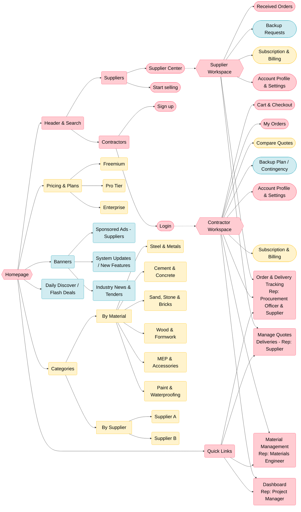

# Assignment2-MVP

# Build-Sync Construction Material Procurement Platform
## 1. System Sitemap 

---

## 2. Assignment 3 - Use Cases & Product Scope

###  Priority Tags Legend
 **[MVP]**: High Priority. Minimum Viable Product core features required for basic operations.
 **[Phase 2]**: Medium Priority. Important structural and catalog features to be implemented next.
 **[Future Scope]**: Low Priority. Marketing, extensions, and supplementary features.
###  List of Use Cases

**Authentication & Workspace Management**
Contractor: Sign up & Login to Contractor Workspace  **[MVP]**
Supplier: Start selling & Login to Supplier Workspace  **[MVP]**
Update Account Profile & Settings (Both roles)  **[MVP]**
Company: Manage Subscription & Billing (Upgrade Freemium, Pro, Enterprise) **[Phase 2]**

**Procurement & Order Fulfillment**
Contractor: Add materials to Cart & Checkout **[MVP]**
Contractor: View and manage "My Orders" **[MVP]**
Supplier: View "Received Orders" & Manage Quotes  **[MVP]**
Both Roles: Order & Delivery Tracking **[MVP]**
Contractor: Compare multiple quotes from different suppliers (Quote Comparison) **[Phase 2]**
Contractor: Purchase Backup Plan / Supply Chain Contingency **[Future Scope]**
Supplier: Manage/Accept Backup Plan requests (Serve as Backup Supplier) **[Future Scope]**

**Project & Material Control (Contractor side)**
Materials Engineer: Material Management **[MVP]**
Project Manager: Dashboard  **[MVP]**

**Search & Catalog Navigation**
Global: Search for materials via Header Search bar  **[MVP]**
Global: View Pricing & Subscription Plans (Freemium, Pro, Enterprise) **[Phase 2]**
Global: Browse Categories By Material (Steel, Cement, MEP, etc.)  **[Phase 2]**
Global: Browse Categories By Supplier (Supplier A, Supplier B)  **[Phase 2]**

**Marketing & Information**
Global: View Sponsored Ads from Suppliers  **[Future Scope]**
Global: Read System Updates & Industry News  **[Future Scope]**
Global: Hunt for Daily Discover / Flash Deals  **[Future Scope]**
